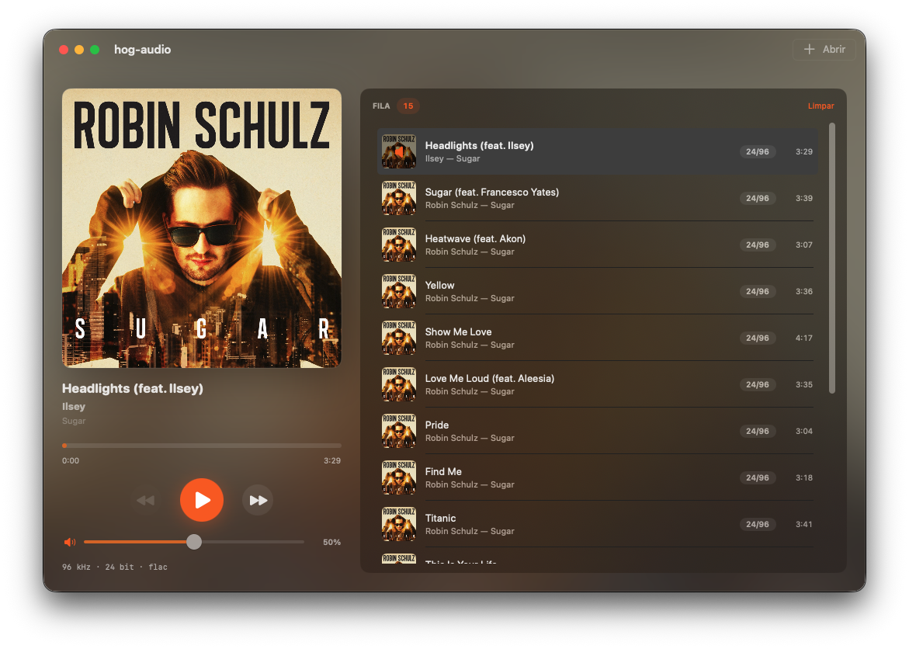

<p align="center">
  
</p>

<h1 align="center">hog-audio</h1>

<p align="center">
  Player de música hi-res, exclusivo para macOS.<br>
  Bit-perfect: seus FLAC e ALAC tocam exatamente como estão no arquivo, na resolução original,
  com o DAC dedicado só à sua música.
</p>

<p align="center">
  <strong>v0.1.0</strong> · macOS 14 ou mais novo · Apple Silicon · licença MIT
</p>

<p align="center">
  <a href="README.md">English</a> · <strong>Português</strong>
</p>

<p align="center">
  
</p>

## O que ele faz

- **Toca em modo exclusivo.** Assume o dispositivo de saída em hog mode
  (`kAudioDevicePropertyHogMode`): enquanto toca, nenhum outro app consegue usar o conversor.
- **Trava o DAC na taxa de amostragem do arquivo.** O conversor muda fisicamente de frequência
  para acompanhar a faixa. Se o dispositivo não aceita essa taxa, o player se recusa a tocar, em
  vez de convertê-la em silêncio.
- **Não passa pelo mixer do sistema.** Entrega ao `AudioDeviceIOProc`, diretamente, os bytes que
  o decodificador produziu.
- **Ajusta o volume no hardware.** Usa o controle do próprio amplificador, o mesmo do volume do
  sistema, e não altera nenhuma amostra. Um teto de segurança protege o ouvido e o equipamento
  ligado à saída, seja fone, caixa ou DAC externo.
- **Toca AAC e MP3 sem acrescentar perda.** O áudio que o decodificador da Apple entrega, em
  float32, chega intacto ao dispositivo; a única perda é a da compressão
  ([ADR 0002 do core](rust/docs/adr/0002-arquivo-com-perda-sem-perda-do-app.md)).
- **Mantém uma fila.** Cada faixa mostra capa, título, artista, álbum, duração e um selo de
  qualidade ("24/96", "16/44.1", "AAC 256"). Quando uma faixa termina, a seguinte começa.
- **Devolve o dispositivo como estava.** Ao terminar, restaura a taxa, o formato e o volume e
  libera o modo exclusivo, inclusive quando é interrompido com Ctrl+C.

A tela sempre mostra o que chega ao DAC. A linha técnica diz "96 kHz · 24 bit · flac · hog
ativo" num FLAC e "48 kHz · AAC 339 kbps · hog ativo" numa faixa com perda.

## Por que "hog"

O hog-audio toca pelo próprio sistema de áudio do macOS, o Core Audio, sem driver nem biblioteca
de terceiros. O som sai pelo conversor do Mac, que alimenta a saída de fone e as caixas, ou por um
DAC externo que o macOS reconheça. Até aqui, os testes foram feitos na saída interna de um
MacBook Air M1.

E ele toca com exclusividade. O nome vem do *hog mode* (`kAudioDevicePropertyHogMode`), o modo
exclusivo do Core Audio: em inglês, *to hog* é tomar algo só para si. É o que o player faz com o
DAC enquanto toca, para que nenhum outro app interfira no som que chega a ele.

## Formatos

- **Bit-perfect:** FLAC, ALAC, WAV, AIFF e CAF de até 24 bits, em qualquer taxa que o dispositivo
  aceite.
- **Com perda, só a da compressão:** AAC-LC e MP3, quando o dispositivo aceita float32 na taxa
  do arquivo, como fazem as saídas internas do Mac.
- **Recusados, com o motivo na tela:**
  - taxa que o dispositivo não suporta, como um FLAC de 192 kHz ou um MP3 de 22,05 kHz na saída
    de fone do Mac;
  - HE-AAC, Opus e os outros codecs com perda;
  - arquivo inteiro de 32 bits ou float de 64 bits num dispositivo float32, que não os reproduz
    sem perda;
  - arquivo com mais canais do que o dispositivo.

## Instalar

Ainda não há versão pronta para baixar: o app é compilado a partir do código-fonte.

Requisitos:
- macOS 14 ou mais novo, testado num MacBook Air M1;
- Rust 1.88 ou mais novo, testado no 1.98;
- toolchain do Swift 6 (Xcode ou Command Line Tools);
- ffmpeg, só para os testes e as provas (`brew install ffmpeg`).

```
make install-app
```

O comando compila o app, instala em `/Applications` (fechando antes uma versão que esteja aberta)
e o abre. Com `make install-app INSTALL_DIR="$HOME/Applications"`, ele é instalado só para o
usuário atual; com `OPEN_APP=0`, não é aberto no fim.

O app não usa sandbox, de propósito: o hog mode não funciona dentro dela. Por isso ele não pode
ir para a App Store, o que não é objetivo do projeto.

## Usar

- **Abrir músicas:** ⌘O (arquivos ou pastas, incluindo as subpastas), arrastar do Finder para a
  janela ou "Abrir com → HogAudio" no Finder.
- **Abrir com duplo clique:** no Finder, use "Obter Informações" num arquivo → "Abrir com" →
  HogAudio → "Alterar Tudo…", uma vez para cada tipo de arquivo.
- **Fila:** as músicas entram no fim da fila. Se ela estava vazia, a primeira fica carregada,
  pronta para tocar. Delete remove a faixa selecionada, e "Limpar" esvazia a fila.

Enquanto o player ocupa o dispositivo, **os outros apps não conseguem tocar nele**, nem com a
música pausada. Se houver outra saída, o macOS manda o som deles para ela: num MacBook com fone,
por exemplo, o som dos outros apps sai pelas caixas. A pausa mantém o dispositivo reservado, para
retomar na hora sem que outro app o tome. Ao fechar o app, tudo volta ao normal.

## Linha de comando

O mesmo núcleo também funciona no terminal, sem janela:

```
make
./rust/target/release/hog-audio musicas/faixa.flac
./rust/target/release/hog-audio --info musicas/faixa.flac
```

O `--info` mostra o que seria negociado, sem ocupar o dispositivo:

```
$ ./rust/target/release/hog-audio --info "02. Sugar (feat. Francesco Yates).flac"
fonte    : flac 96000 Hz / 24 bits / 2 canais / 219.1 s
device   : Alto-falantes (MacBook Air)
rate atual: 44100 Hz
rates    : 44100, 48000, 88200, 96000
formatos : 4 físicos disponíveis
           96000 Hz / 32 bits float / 2 canais
           88200 Hz / 32 bits float / 2 canais
           48000 Hz / 32 bits float / 2 canais
           44100 Hz / 32 bits float / 2 canais
negociado: 96000 Hz / 32 bits float
afinação : desligada — saída bit-perfect
```

Outras opções:
- `--volume 35` ou `--volume -18dB`: o volume da reprodução, em porcentagem ou como atenuação
  exata;
- `--max-volume 60`: muda o teto de segurança, que por padrão é de 50%;
- `--tuning curva.txt`: liga a afinação (veja abaixo);
- `--dump arquivo.raw`: grava num arquivo os bytes que iriam ao DAC, sem reproduzir.

## Volume e segurança

Volume no máximo pode machucar o ouvido e danificar o equipamento ligado à saída, seja fone,
caixa ou amplificador; a saída de fone do Mac, por exemplo, entrega tensão suficiente para isso.
Por isso o volume é ajustado **depois de o player assumir o dispositivo e antes de qualquer som
sair**, e volta ao valor anterior no fim. Sem `--volume`, ele só é alterado se estiver acima do
teto.

Os decibéis vêm do próprio amplificador, não de uma fórmula: pedir `-30dB` resulta em exatamente
−30,0 dB no dispositivo. O valor exibido é sempre lido do hardware, porque a conversão informada
pelo HAL não corresponde à curva que ele de fato aplica.

O código contorna duas armadilhas do Core Audio:
- **A primeira mudança de volume depois de reconfigurar o formato é descartada em silêncio.** O
  HAL responde `noErr`, e a leitura seguinte devolve o valor pedido, que vem de um cache. O player
  confere com uma nova leitura, um pouco depois; se um volume pedido explicitamente não se
  confirma, ele cancela a reprodução em vez de tocar no volume errado.
- **Com o dispositivo ocupado, o macOS aponta a "saída padrão" para outro dispositivo.** Quem
  consulta a saída padrão durante a reprodução, inclusive o `system_profiler`, vê o volume do
  dispositivo errado. Por isso o player nunca usa a saída padrão enquanto ocupa um dispositivo.

## Afinação (`--tuning`)

É um segundo modo de reprodução, que aplica uma curva de resposta em frequência escolhida por
você. **Com a afinação ligada, a saída deixa de ser bit-perfect**, porque aplicar um filtro é
mudar cada amostra. O hog mode e a taxa travada continuam valendo.

A curva é um arquivo de texto com uma frequência e um ganho por linha. Um CSV exportado de uma
medição funciona direto, e `#` marca comentário:

```
# frequência (Hz)   ganho (dB)
20      12.5
1000    -0.6
3200    10.0
20000  -10.6
```

- O filtro é um FIR de fase mínima, com 4096 coeficientes, calculado pelo cepstro real da curva.
  A resposta obtida fica a menos de 0,02 dB da pedida em toda a faixa audível.
- O preamp não é opcional: a curva inteira desce até o pico encostar em 0 dBFS, porque ganho
  positivo no domínio digital satura.
- Num dispositivo de formato inteiro, a conversão de volta do float usa dither TPDF.
- O modo bit-perfect não passa por nenhuma linha da afinação
  ([ADR 0001 do core](rust/docs/adr/0001-modo-afinado-ao-lado-do-bit-perfect.md)).

## Como o bit-perfect é provado

É o que diferencia este projeto de um player comum: qualquer mudança no caminho do áudio precisa
continuar passando nestas provas.

```
make verify FILE=testdata/t96_24.flac BITS=24
make verify-pause FILE=testdata/t96_24.flac
make verify-volume FILE=testdata/t96_24.flac
make verify-lossy FILE=testdata/t44_aac.m4a
```

- **`verify`:** compara, amostra por amostra, os bytes que o player mandaria ao DAC com o PCM que
  o ffmpeg extrai do mesmo arquivo. O ffmpeg é o oráculo, uma implementação independente. Vale
  para arquivo estéreo, numa taxa que o dispositivo suporte.
- **`verify-pause`:** o fluxo com uma pausa no meio sai idêntico ao fluxo sem pausa; nenhum byte
  se perde nem se repete.
- **`verify-volume`:** as amostras gravadas são idênticas com o volume em 20% e em 90%; o volume
  muda no dispositivo, nunca no sinal.
- **`verify-lossy`:** no AAC e no MP3, a saída do player bate byte a byte com o mesmo arquivo
  decodificado pelo `afconvert`, que usa o mesmo decodificador da Apple. Prova que o app não
  acrescenta nada depois do decodificador. Vale para arquivo estéreo.

O limite delas: todas rodam no modo `--dump`, que passa pelo decodificador, pelo ring buffer e
pelo alinhamento de frame, mas não executa o callback de tempo real. Por isso o `io_proc` tem
testes próprios, em `rust/src/playback.rs`, que o chamam diretamente com um `AudioBufferList`
sintético.

Os arquivos de áudio de teste não ficam no repositório: o `make fixtures` os gera com o ffmpeg e
o `afconvert`.

## Proteção contra ruído

Se o formato que o decodificador produz não for exatamente o que o DAC espera, o resultado não é
uma distorção leve: é ruído branco em volume total. Três barreiras impedem isso:
1. O tamanho do frame vem do próprio dispositivo, nunca de `bitsPerChannel / 8`, porque amostras
   de 24 bits podem vir em contêineres de 32 bits.
2. Depois de configurar a entrega, o player relê o formato que o decodificador de fato assumiu e o
   compara com o do dispositivo. Se divergir, ele para antes de tocar.
3. No callback, todo byte enviado é dado do arquivo ou zero. Buffer curto, canal a mais ou pedido
   maior que o previsto viram silêncio, nunca memória não inicializada.

## Por que float32 continua sendo bit-perfect

As saídas internas dos Macs com Apple Silicon só aceitam float32. Isso não compromete a
integridade: o float32 tem 24 bits de mantissa, então todo inteiro de até 24 bits é representado
exatamente, e a conversão de ida e volta devolve o mesmo valor. Arquivos acima de 24 bits são
recusados num dispositivo float32. No AAC e no MP3, o decodificador já entrega float32, que vai ao
dispositivo sem conversão.

## Se o processo morrer

O modo exclusivo fica preso ao processo, e o `coreaudiod` o libera quando o processo termina,
mesmo com `kill -9`. O Mac nunca fica mudo:
- **Fim da faixa, Ctrl+C, `SIGTERM`, `SIGHUP` ou `SIGQUIT`:** o player libera o modo exclusivo e
  restaura a taxa.
- **`SIGKILL` ou travamento:** o sistema libera o modo exclusivo, mas a taxa fica na última usada.
  Para corrigir, toque qualquer outra coisa ou ajuste no app Configuração de Áudio e MIDI.

## Limites conhecidos

- **Sem conversão de taxa:** uma faixa numa taxa que o dispositivo não suporta é recusada, por
  escolha.
- **Sem gapless:** a cada troca de faixa, o player libera e retoma o dispositivo, e pode mudar a
  taxa do DAC.
- **Fila básica:** sem avançar dentro da faixa, modo aleatório, repetição ou reordenação.
- **Troca de saída:** plugar o fone no meio da faixa não leva o som para ele; tirar o fone
  interrompe a reprodução e mostra um aviso.
- **WAV, AIFF e CAF float de 32 bits** são recusados por engano num dispositivo float32 (veja o
  [ROADMAP](docs/ROADMAP.md)).
- **Fone de alta impedância:** a saída que ajusta a tensão para esses fones existe no MacBook Pro
  14"/16" (2021) em diante, no MacBook Air M2 e no Mac Studio. O MacBook Air M1 não a tem.

O que vem a seguir está no [ROADMAP](docs/ROADMAP.md).

## Estrutura

Duas linguagens, cada uma com um papel ([ADR 0002](docs/adr/0002-consolidar-o-core-em-rust.md)):

```
rust/      o núcleo inteiro: HAL, formato, ring buffer, IOProc, decodificação e a CLI
apps/      o app SwiftUI (apps/player), que fala com o núcleo por uniffi, e um protótipo em GPUI
tools/     verificador de bit-perfect, gerador dos arquivos de teste, ícone e instalação
logos/     a logo e o ícone em SVG
docs/      ROADMAP, ADRs e o registro dos trabalhos
```

O núcleo, por módulo:

```
rust/src/format.rs       decide a taxa e o formato; código puro, sem Core Audio
rust/src/volume.rs       interpreta o volume pedido e o teto; código puro
rust/src/transitions.rs  regras da máquina de estados; código puro
rust/src/ring.rs         fila sem travas entre o decodificador e a thread de tempo real
rust/src/source.rs       decodificação pelo ExtAudioFile
rust/src/device.rs       HAL: modo exclusivo, travamento do formato, volume, IOProc, restauração
rust/src/playback.rs     o estado que o IOProc lê e o próprio callback de tempo real
rust/src/engine.rs       a camada que coordena hardware, arquivo e threads
rust/src/api.rs          a interface uniffi que o Swift enxerga, só de controle
rust/src/main.rs         a CLI
```

A decisão de "isto pode tocar sem perda?" fica isolada do hardware, em código puro: é a regra que
mais importa e a única que dá para verificar sem plugar um fone.

## Desenvolvimento

Num clone novo, gere primeiro os arquivos de teste; o áudio não fica no repositório:

```
make fixtures    # gera testdata/ com o ffmpeg e o afconvert
make test        # fmt, clippy e os testes do núcleo e do app
make hw-test     # os testes que ocupam o dispositivo de verdade, em série (tocam tons)
make app         # monta apps/player/HogAudio.app sem instalar
```

O `make test` trata o `clippy -D warnings` como regra obrigatória, não como sugestão: o `unsafe`
do HAL e do IOProc é onde moram os defeitos mais caros deste projeto. Um teste que depende de um
arquivo de teste ausente falha e diz qual comando rodar.

O IOProc roda numa thread de tempo real: dentro dele só há cópia de memória e operações atômicas,
nada de alocar, travar ou imprimir. Quem for mexer nesse caminho deve começar pelo comentário no
topo de `rust/src/playback.rs`.

## Licença

[MIT](LICENSE). O código de terceiros mantém a própria licença: `apps/gpui/vendor/gpui_macos`
(Apache-2.0, do Zed) e os trechos do protótipo adaptados do Pawse (MIT, com o aviso no próprio
arquivo).
